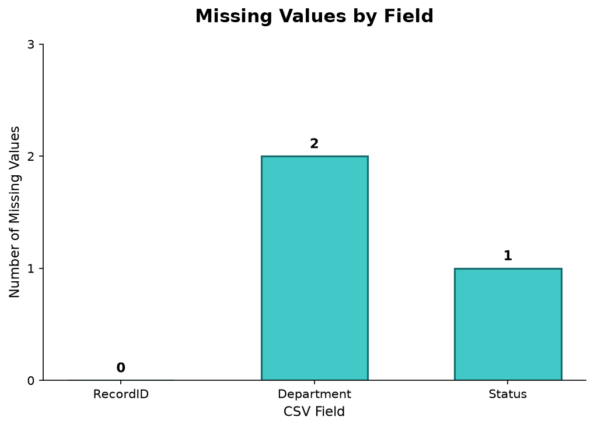

# Continuous Intelligence Project Report

**Author:** Sabriya Sowers
**Course:** Continuous Intelligence - Project 01
**Date:** October 2026

## Overview

This project establishes a professional Python environment for developing and running continuous intelligence applications.

I expanded the original Python pipeline to explore how Python can support data quality monitoring. Using a small fictional healthcare department dataset, I added a check for missing values and created a bar chart to visualize the results.

The goal was to practice working with CSV data, Python logging, and basic data quality checks while connecting the project to my interest in data governance.

## Data

I created a fictional healthcare department dataset containing five records with three fields:

- **RecordID:** A unique identifier for each record.
- **Department:** The healthcare department name.
- **Status:** The status associated with the record.

Each row represents one fictional healthcare department record.

The dataset is stored in [data/department_records.csv](https://github.com/ssowers2/cintel-01-getting-started-sowers/blob/main/data/department_records.csv).

**Data Source:** I created this fictional dataset specifically for the project. It does not contain real patient or organizational information, and no external data source or license is required.

## Techniques Applied

I used the following tools and techniques:

- **Python:** To develop and run the data quality check.
- **CSV library:** To read the fictional healthcare department dataset.
- **Python logging:** To display the missing-value results and record pipeline execution.
- **Matplotlib:** To create a bar chart showing missing values by field.
- **uv:** To manage the Python environment and project dependencies.
- **Git and GitHub:** To track changes and store the project.
- **Ruff, ty, and pytest:** To support code quality and verification.
- **Zensical and GitHub Pages:** To publish project documentation.

The main data quality check is located in `src/cintel/pipeline.py`.

The visualization code is located in `src/cintel/data_quality_chart.py`.

## Custom Modifications

**What I changed:**

I initially added a basic missing-value check to `src/cintel/pipeline.py` using a small list of sample data.

The original example used:

```python
sample_data = ["Cardiology", "", "Neurology", ""]
missing_count = sample_data.count("")
```

This identified two missing values.

I then expanded the experiment by creating a separate CSV dataset containing five fictional healthcare department records.

I updated the pipeline to read the CSV file and count missing values across all three fields.

I also created a separate Python script to generate a bar chart using Matplotlib.

**Why I chose this change:**

I wanted to explore how Python could help identify data quality issues because this connects to my interest in data governance.

I also wanted to practice working with a separate dataset instead of keeping the sample data directly in the Python code.

**Observed effect:**

The original sample-data check identified two missing values.

After switching to the CSV dataset, the pipeline identified three missing values and completed successfully.

## Methods and Settings

The goal was to identify missing values in the fictional healthcare department records.

I used Python's `csv.DictReader()` to read the CSV file and the `sum()` function to count empty strings across the records.

The missing-value check considers a field missing when its value is an empty string (`""`).

The experiment used the following settings:

- **Dataset:** `data/department_records.csv`
- **Number of records:** 5
- **Fields checked:** RecordID, Department, and Status
- **Missing-value definition:** An empty string
- **Missing-value calculation:** Count empty strings across all fields
- **Visualization:** Bar chart created using Matplotlib

No statistical models, random seeds, or thresholds were used in this experiment.

## Verification

I performed the following checks to verify the results:

1. Ran the Python pipeline successfully.
2. Ran the pipeline a second time and received the same result of three missing values.
3. Manually reviewed the CSV file to confirm the missing values.
4. Verified that the bar chart displayed the correct counts.

The manual review confirmed:

- RecordID: 0 missing values
- Department: 2 missing values
- Status: 1 missing value

These results matched the Python output.

The project also uses automated Git hooks to check formatting and code quality before committing changes.

## Results

The pipeline successfully identified **3 missing values** across the five fictional healthcare department records.

| Field | Missing Values |
|---|---:|
| RecordID | 0 |
| Department | 2 |
| Status | 1 |
| **Total** | **3** |

The pipeline displayed the following message:

```text
Missing values found: 3
Pipeline executed successfully!
```

### Data Quality Visualization

The following bar chart shows the number of missing values in each field.



The chart was created using Matplotlib and saved in the `docs/images` folder.

## Observations

The results show that:

- Department had the highest number of missing values, with two.
- Status had one missing value.
- RecordID had no missing values.
- Three fields were missing across the five records.

The bar chart shows that missing values were not evenly distributed across the three fields.

## Interpretation and Insights

This experiment demonstrates how Python can help identify potential data quality issues in a dataset.

The Department field had the most missing values, which suggests that it would be a useful area to review if this were an actual healthcare dataset.

From a data governance perspective, identifying missing values can help organizations understand where data quality improvements may be needed.

I also learned how to separate data from Python code, use logging to display results, and create a visualization to communicate findings.

## Limitations

This experiment has several limitations:

- The dataset contains only five fictional records.
- The missing-value check only identifies empty strings.
- It does not identify missing values represented by spaces or other text.
- It does not check for duplicate records, invalid values, or inconsistencies.
- The results are intended for learning and do not represent actual healthcare data quality.

Because the dataset is small and fictional, the results cannot be generalized to real healthcare systems.

## Next Steps

In future projects, I would like to expand the data quality checks to include:

- Identifying duplicate records.
- Detecting invalid or unexpected values.
- Checking for inconsistencies between fields.
- Testing the process with larger datasets.
- Creating additional visualizations to monitor data quality over time.

These improvements would help me continue exploring how Python can support data quality monitoring and data governance.

---

## Documentation and Project Links

- [My GitHub Repository](https://github.com/ssowers2/cintel-01-getting-started-sowers)
- [My Hosted Documentation](https://ssowers2.github.io/cintel-01-getting-started-sowers/)
- [Fictional CSV Dataset](https://github.com/ssowers2/cintel-01-getting-started-sowers/blob/main/data/department_records.csv)
- [Original Example Repository](https://github.com/denisecase/cintel-01-getting-started)
- [Professional Python Workflow Guide](https://denisecase.github.io/pro-analytics-02/)
- [Professional Python Project Explainer](https://pup-pack.github.io/professional-python-project-explainer/)

### Additional Documentation

- [Project Instructions](project-instructions.md)
- [Glossary](glossary.md)
- [API](api.md)
